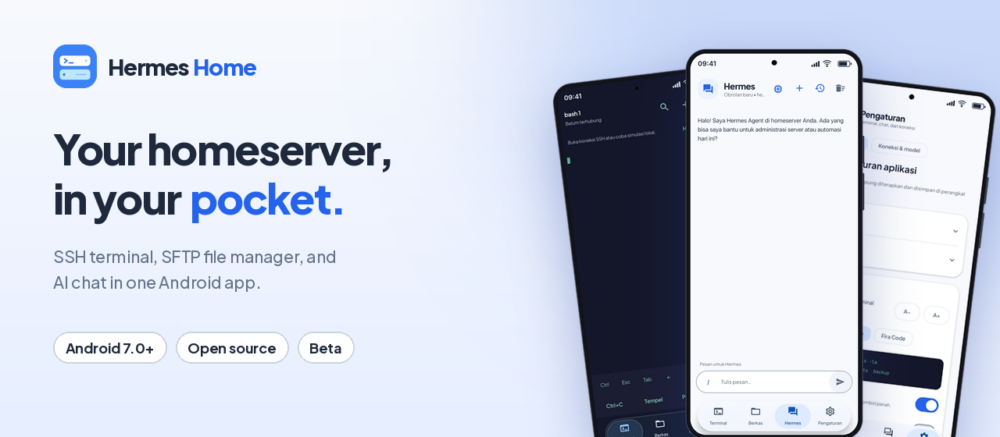
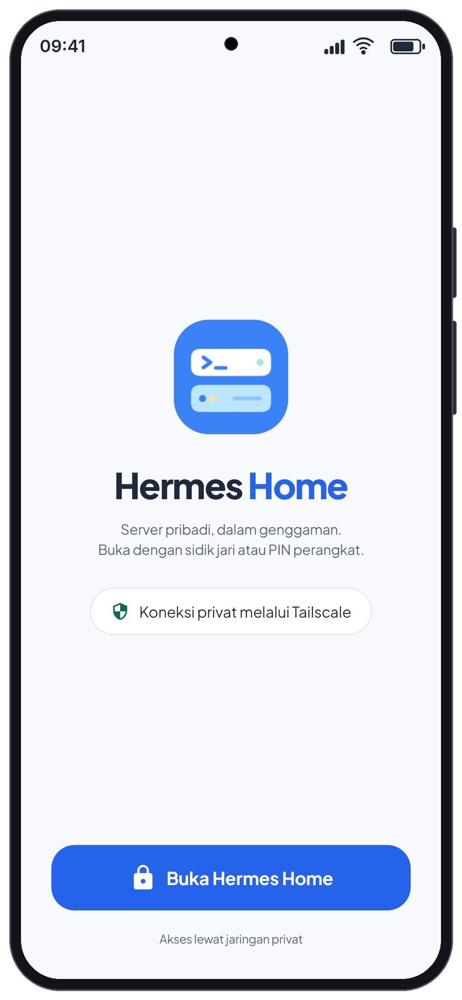
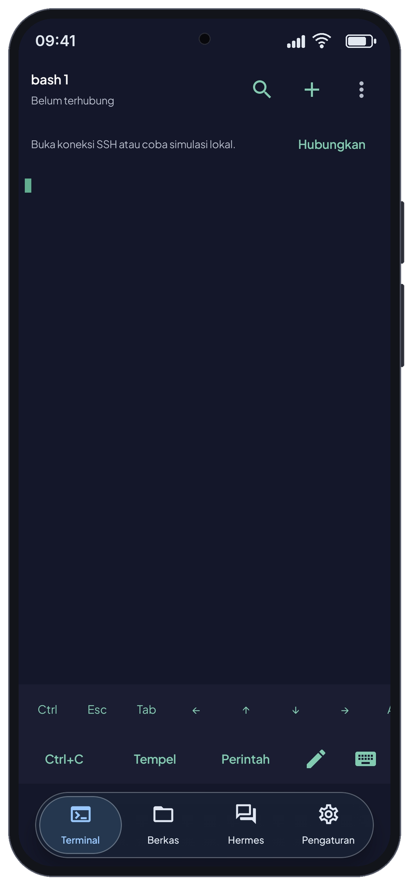
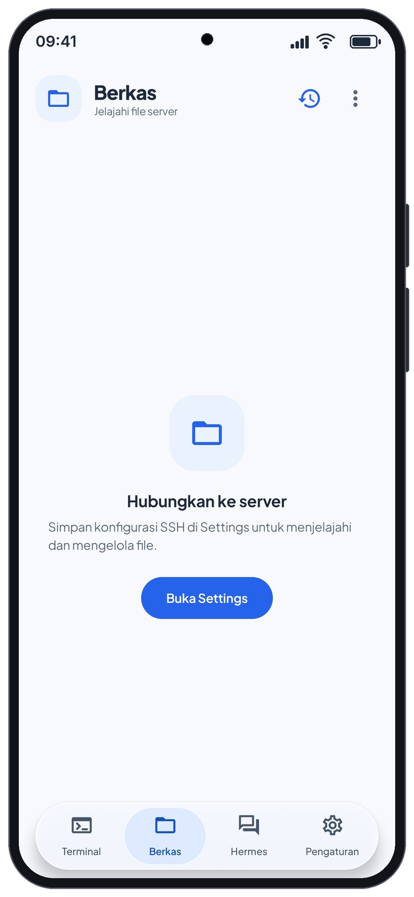
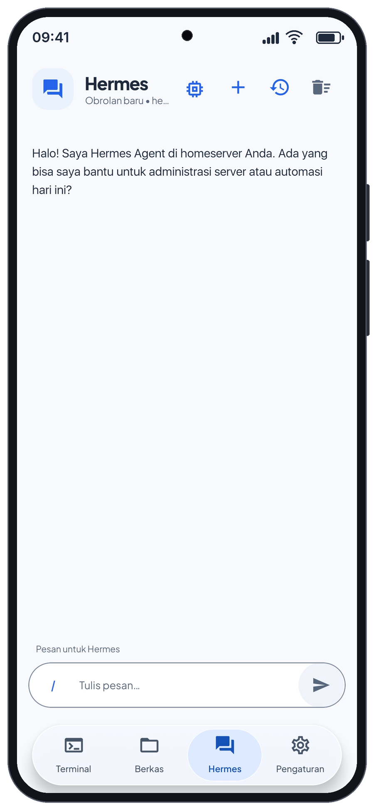
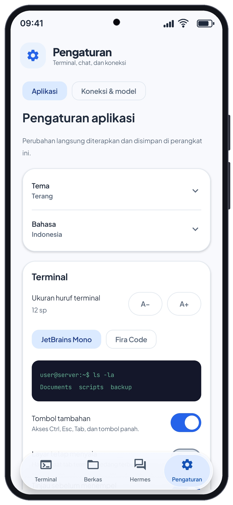
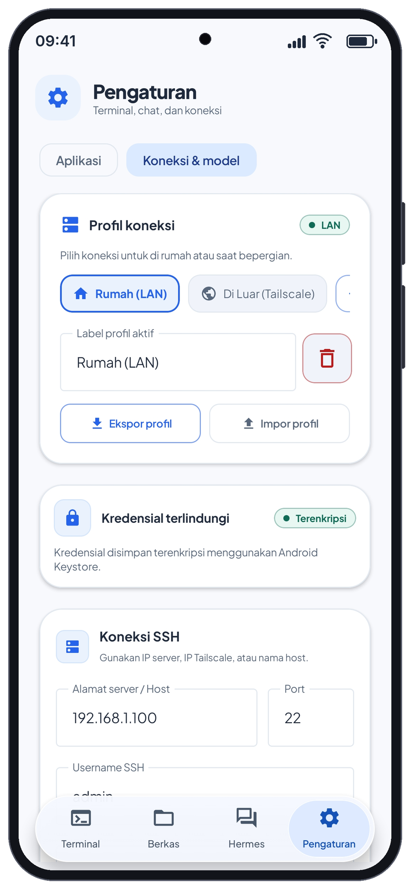
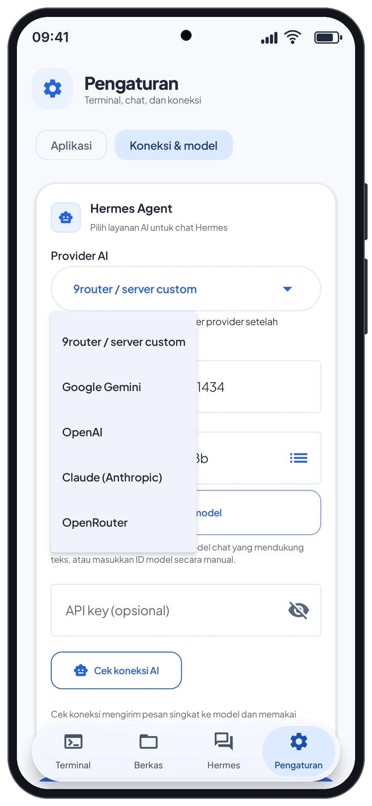
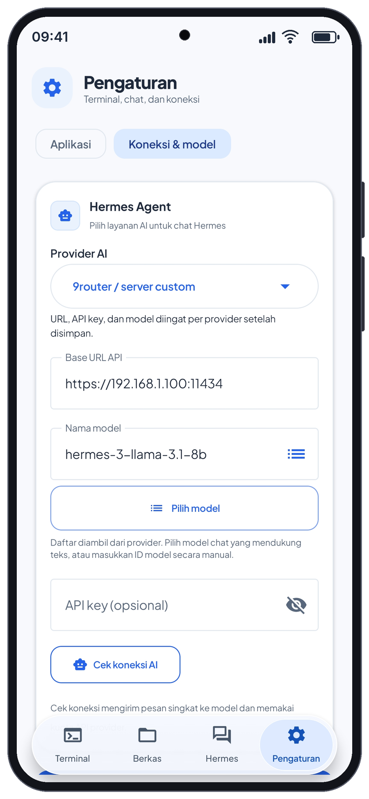
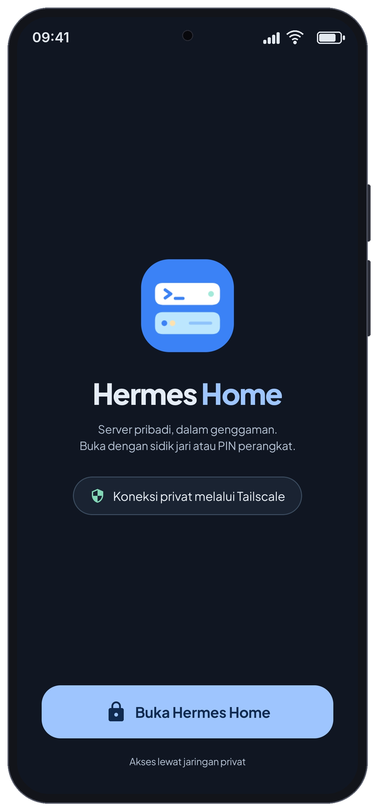

<div align="center">



# Hermes Home

**Your homeserver, in your pocket.**

An Android app for interactive SSH, SFTP file management, and chat with the AI provider or server you choose.

[](CHANGELOG.md) [](#requirements) [](LICENSE)

[Download published beta](https://github.com/knxxy205/Hermes-Home/releases/tag/v1.3.1-beta.1) · [Website](https://knxxy205.github.io/hermes-home-website/) · [Setup](#setup) · [Updating](#updating-an-existing-installation) · [Report a bug](https://github.com/knxxy205/Hermes-Home/issues)

</div>

> [!IMPORTANT]
> This source prepares **1.3.2**. The features and images below describe the updated app; the published download above remains **1.3.1-beta.1** until a new signed beta is published. The 1.3.2 candidate still needs a retained-data update test on a device. Do not install the older `1.3.0-beta.1`, which has a known startup crash.

## What Hermes Home does

Hermes Home brings four tabs together: Terminal, Files, Hermes, and Settings. Connect to an existing server over LAN or a private network such as Tailscale, browse its files, and ask a configured model to explain commands or file contents. The app does not include a hosted server, an AI subscription, or a VPN service.

The updated interface includes light, dark, and system themes, Indonesian and English language choices, floating bottom navigation, and separate settings for app preferences and connections. Terminal sessions and chat drafts stay available when switching tabs.

## Screenshots

<p align="center">
  
  
  
</p>
<p align="center"><em>Unlock, Terminal, and Files. Disconnected screens do not represent a live server session.</em></p>

<p align="center">
  
  
  
</p>
<p align="center"><em>Chat, application preferences, and connection profiles. Connection screenshots use example values.</em></p>

## Terminal

- Open up to **five terminal sessions**. Choose a saved server, rename a session, switch sessions, disconnect, or close one independently.
- Keep SSH sessions owned by the application rather than a tab. A foreground service keeps an active connection visible in Android while the app remains running. Removing the app task ends that service; network changes, server behavior, force-stop, and Android power restrictions can interrupt connections.
- Confirm the SSH host-key fingerprint on first connection. The app compares subsequent connections with the trusted key and asks you to review changes.
- Use Ctrl, Alt, Esc, Tab, arrow keys, Ctrl+C, paste, a command editor, and a keyboard toggle. Hardware keyboard modifiers also reach the terminal.
- Review multiline pastes before sending them. Enable paste preview for single-line text too.
- Long-press to select terminal text, adjust selection handles, and use Android's copy/paste actions.
- Search the current screen and scrollback, move between matches, and refresh the search after more output arrives.
- Browse history with pixel scrolling and return to the latest output. Each session retains its own viewport.
- Pick JetBrains Mono or Fira Code, adjust text size from **10 to 24 sp**, or pinch to resize. Extra keys and keeping the screen awake are optional.
- Save, search, edit, and remove reusable commands. Review commands before inserting or sending them.
- Try the explicitly labeled local simulation when no SSH server is available. It is a demonstration, not a live shell on your server.

SSH login currently uses a username and password. Public-key authentication is not exposed in the app's connection settings.

## Files over SFTP

### Browse and organize

- Open remote folders using full-width rows, breadcrumbs, or a manually entered path.
- Sort by name, modification time, or size; choose whether hidden files appear. These preferences persist.
- Create files and folders, rename items, preview supported files, and delete files or empty folders.
- Select several items for supported batch operations. Delete confirmation includes the target paths, and the result distinguishes successful and failed operations.
- Inspect names, paths, extensions, size, permissions, and modification times through file information.

### Find files

Search recursively inside the current folder. Results show their remote paths and appear progressively. Cancel an active search to return to the last successful directory listing; Refresh fetches the current server state.

Search does not follow directory symlinks. It stops at 5,000 results, 10,000 scanned folders, 64 levels, or a 20-second scanning budget. A blocked network call can extend that budget to its connection timeout. Partial results and unreadable directories are labeled.

### Upload and download

- Choose one or more local files and upload them with background work. Each batch records its destination and connection profile so changing folders does not silently redirect the upload.
- Review destination conflicts before replacing files. The upload flow retains selected sources for background work and retries when available.
- Follow upload progress and results in notifications or transfer history. History records each file's destination, byte count, state, and error.
- Cancel a batch or retry unfinished files while retaining successful entries. If source access is unavailable, the app offers reselection.
- Open a batch from its notification after normal app unlock, or navigate to its destination with the original profile.
- Download files to a folder selected with Android's folder picker. Existing local filenames are preserved by numbering new copies.

Folder downloads are not supported. Downloads require the app process to stay alive and do not automatically resume after it is killed. Upload retry restarts unfinished files; it is not a guarantee of byte-level transfer resume.

## Hermes chat

### Providers and models

Choose a provider in **Settings > Connections & models**:

| Provider | Connection |
| --- | --- |
| 9router / custom server | Your OpenAI-compatible API base URL; an API key is optional if the server permits it. |
| Google Gemini | Google's OpenAI-compatible endpoint with your API key. |
| OpenAI | OpenAI's chat-completions API with your API key. |
| Claude (Anthropic) | Anthropic's native Messages API with your API key. |
| OpenRouter | OpenRouter's chat-completions API with your API key. |

The app remembers saved URL, key, and model settings for each provider. Provider accounts, credits, model permissions, and service availability are your responsibility. Connection checks send a short model request and can consume provider quota.

Open the model picker from the icon at the top right of chat, its title, `/model`, or connection settings. Search the server's catalog, see the current model first, and select a returned model ID. The picker uses a fixed window so scrolling a long list does not drag the whole panel. If catalog discovery is unavailable, you can enter the model ID manually in connection settings.

<p align="center">
  
  
</p>

### Conversations and commands

- Start a conversation, keep locally saved sessions, reopen history, and confirm before clearing the active chat through the header action.
- Read replies with headings, lists, tables, inline code, and fenced code blocks. Code blocks preserve indentation, scroll horizontally, and have a code-copy action.
- Send supported file contents from Files to Hermes for explanation or review.
- Review a suggested shell command before running it on the configured server or opening it in the interactive terminal. The app shows the target and requires confirmation; the model does not execute suggested commands automatically.
- Set chat text size from **12 to 22 sp**, show message timestamps, choose whether Enter sends, select an answer style, or add up to 2,000 characters of response instructions.

| Command | Behavior |
| --- | --- |
| `/model` | Open the model picker. `/models` is an alias. |
| `/model name` | Open the picker with a search filter. |
| `/effort` | Show the saved effort and available commands. |
| `/effort low`, `/effort medium`, `/effort high` | Save the requested reasoning effort for subsequent chat messages. |
| `/effort default` | Remove the override and follow the model's default. |
| `/history` | Open saved conversations. `/sesi` is an alias. |
| `/status` | Show the selected profile, model, saved effort, and configuration status. This is not a live server-health check. |
| `/profile` | List saved connection profiles for switching. `/profiles` is an alias. |
| `/clear` | Clear the active chat. `/reset` is an alias. |
| `/help` | Show command help. `/start` is an alias. |

Reasoning effort defaults to **unset**. The app sends a provider-specific field only for recognized model families: `reasoning_effort` for OpenAI and Gemini, `reasoning.effort` for OpenRouter, and `output_config.effort` for Claude. It omits effort for unknown models and custom endpoints, including custom routers whose forwarding behavior is not established. Saving High does not force an unsupported model to use it; individual model/API restrictions can still reject a request. Effort is separate from the concise/step-by-step/detailed answer-style setting.

The app sends the current message with up to ten eligible preceding messages. A saved conversation can contain more history than the context included in each request. Reply quality and any tools offered by a server-side agent depend on that backend.

## Appearance, profiles, and app lock

- Choose **Light**, **Dark**, or **System** theme. The terminal retains its dark canvas for reading output.
- Choose **Indonesian**, **English**, or the system language. Existing chat messages, filenames, code, and server output are not translated.
- Switch between saved connection profiles, such as home LAN and Tailscale. Each profile stores the server configuration.
- Export and import password-protected connection-profile backups. These exports contain connection credentials; protect the file and its password. They do not transfer chat history between separate app packages.
- Unlock explicitly using biometrics or the device credential when supported. An installed app lock does not replace Android device security or server authentication.
- Read privacy, security, app licensing, and third-party notices offline in Settings.

The floating navigation keeps Terminal, Files, Hermes, and Settings accessible. The app requests the highest supported display refresh rate at the current resolution, including 120 Hz where available. Android, battery settings, and the hardware determine the actual refresh rate; this is not a measured 120 FPS claim.

<p align="center">
  
  
</p>

## Requirements

- Android **7.0 (API 24)** or later.
- An SSH server with SFTP enabled for terminal and file management.
- Network access from the phone to that server, using LAN or a private network such as Tailscale. Install and configure any VPN separately.
- Optional: an AI provider account/key or your own compatible endpoint for chat. Chat does not require SSH to be configured.

Use HTTPS for public AI endpoints. Plain HTTP is restricted to local/private destinations, including redirects and their resolved network addresses.

## Setup

1. Download a signed APK from [GitHub Releases](https://github.com/knxxy205/Hermes-Home/releases) and install it. Android may ask you to permit installation from your browser or file manager.
2. Unlock Hermes Home using the app's unlock button and Android authentication.
3. Open **Settings > Connections & models**. Add or select a profile, then enter SSH host, port, username, and password. The example addresses in screenshots are not a shared service.
4. Save the profile and connect from Terminal or Files. Compare the SSH host-key fingerprint with a trusted source before accepting it; investigate an unexpected change.
5. For chat, choose a provider, save its base URL/API key/model, and select a text-chat model. Use the AI connection check to verify a reply.
6. Open **Settings > App** to choose language, theme, terminal controls, or chat preferences.

## Updating an existing installation

Install the next correctly signed release APK **over the existing GitHub app**. Keep the old app installed and do not clear its data. Android can retain its profiles, local preferences, and conversation history when an update uses the same application ID and signing identity.

| Build | Package | Intended use |
| --- | --- | --- |
| Signed GitHub release | `com.aistudio.homeserver.thns` | Updates the existing GitHub beta when signed with its original key. Source 1.3.2 uses version code 6, following 1.3.1's code 5. |
| Local debug/compact preview | `com.aistudio.homeserver.thns.preview` | Installs alongside the release for testing. It does not update or share private data with the main app. |

Two launcher icons mean both packages are installed. Updating the main app does not automatically merge data created in the preview. Export/import connection profiles if needed, and verify the main app before removing a preview. If Android reports a signature conflict, do not uninstall the existing app to bypass it; obtain the candidate signed with the original release identity.

Before a wider rollout, test an update from 1.3.1 without uninstalling and confirm saved profiles, chat history, unlock, SSH, SFTP, and uploads. See [update compatibility](docs/update-compatibility.md) and [release build instructions](docs/release-build.md).

## Build and test

Use **Java 17**, **Gradle 9.3.1**, and **Android SDK 36.1**. JVM tests use a **Java 21 toolchain**; install one or allow the configured Gradle toolchain resolver to obtain it. Runtime code targets Java 11.

```sh
# Development build, installed as Hermes Home Preview
gradle :app:assembleDebug

# JVM regressions and compilation/packaging of device tests
gradle :app:testDebugUnitTest :app:assembleDebugAndroidTest

# Release lint and release build
gradle :app:lintRelease :app:assembleRelease
```

| Output | Location |
| --- | --- |
| Debug preview APK | `app/build/outputs/apk/debug/app-debug.apk` |
| Compact preview APK | `app/build/outputs/apk/compact/app-compact.apk` |
| Unsigned release, without signing configuration | `app/build/outputs/apk/release/app-release-unsigned.apk` |
| Signed release, with signing configuration | `app/build/outputs/apk/release/app-release.apk` |

The compact preview is non-debuggable but still uses the preview package and development signing identity. Code/resource shrinking are disabled for both compact and release after startup regressions in shrunk builds. Unsigned APKs are verification artifacts and cannot serve as installable updates.

GitHub's verification workflow runs tests/lint and produces a development APK. The separate signed-beta workflow verifies the release package and original certificate, uploads a review artifact, and runs Android startup/authentication checks before optional publication. Publishing defaults to off. Follow [release signing instructions](docs/release-build.md); do not commit a keystore or its passwords.

## Validation and beta limitations

The latest UI/picker runtime changes passed **73 JVM tests**, including SSH/SFTP fixtures, model request formatting, preference persistence, terminal motion, picker boundary scrolling in both themes, and navigation margin rendering. Android-test APK assembly and the unsigned 1.3.2 release assembly also passed. Device-test assembly is not a device-test execution. See [picker verification](docs/model-picker-fix.md) and [performance changes](docs/performance.md) for scope.

- The 1.3.2 signed candidate still needs its own retained-data update and phone checks. Earlier 1.3.1 emulator/phone results do not establish that the new candidate passes those checks.
- Physical 120 Hz timing, keyboard animation, and frame rates have not been measured here.
- Transfers and terminal connections remain subject to network, server, Android lifecycle, and battery restrictions.
- File downloads do not resume after process death; folder downloads and nonempty-folder deletion are not supported.
- The model catalog can include models unsuitable for text chat. Select a text-capable model that your provider account permits.
- Custom OpenAI-compatible servers vary in supported endpoints, fields, and response formats. Effort overrides are omitted for custom servers.
- Terminal search operates on rendered rows, with up to 1,000 matches. The app's local simulation is for demonstrations.

For testing details, see the [Files beta guide](docs/files-beta-testing.md), [terminal/chat interactions](docs/terminal-chat-ux.md), and [release verification history](docs/release-readiness.md).

## Security and privacy

SSH passwords, provider API keys, saved chat sessions, and transfer-history contents are stored locally using the app's encrypted vault/journal. AES-GCM keys are held by Android Keystore. App appearance preferences use a separate local preferences store.

SSH host-key verification protects the selected connection only when you verify fingerprints and investigate changes. Android cloud backup/device transfer exclude the app's preferences. Password-protected profile exports include credentials and need their own secure handling.

Chat messages, selected file contents, and connection requests go to the endpoints you configure. A custom router can forward chat to another provider according to its configuration. The app does not supply those services or control their retention policies. Suggested commands execute only after an app confirmation.

Read the [privacy policy](PRIVACY.md), [security reporting policy](SECURITY.md), and the services' own terms before sending private data. Do not put keys, passwords, private server details, or unredacted logs into a public issue.

## Third-party notices and license

Hermes Home's original code is **GPL-3.0-only**. Terminal emulator/renderer sources derive from [Termux](https://github.com/termux/termux-app) v0.118.0; applicable upstream licenses and exceptions remain attached. Font and library notices are included in the app.

See [LICENSE](LICENSE), [THIRD_PARTY_NOTICES.md](THIRD_PARTY_NOTICES.md), the [license decision](docs/license-review.md), and full texts under `app/src/main/assets/licenses`. Recipients of covered APKs must have access to the corresponding source and build instructions. The app comes without warranty.

© 2026 knxxy205 and Hermes Home contributors.
