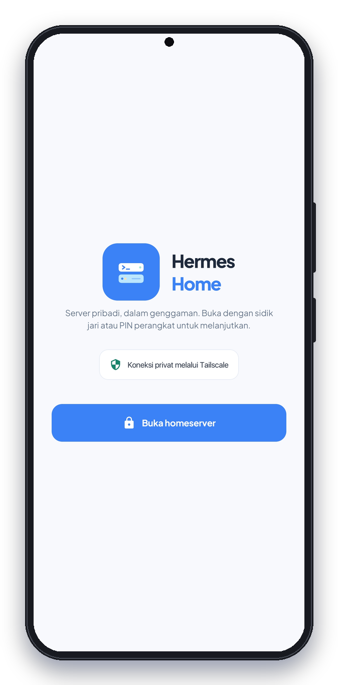
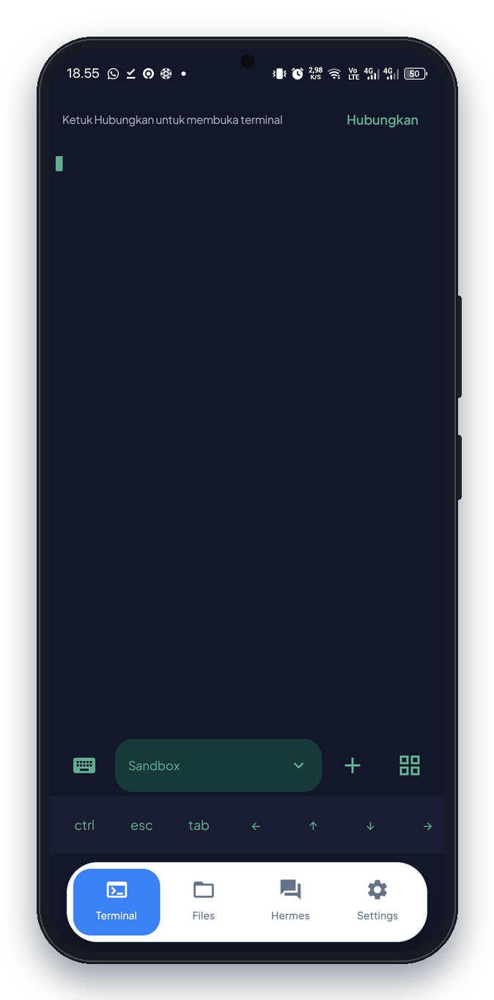
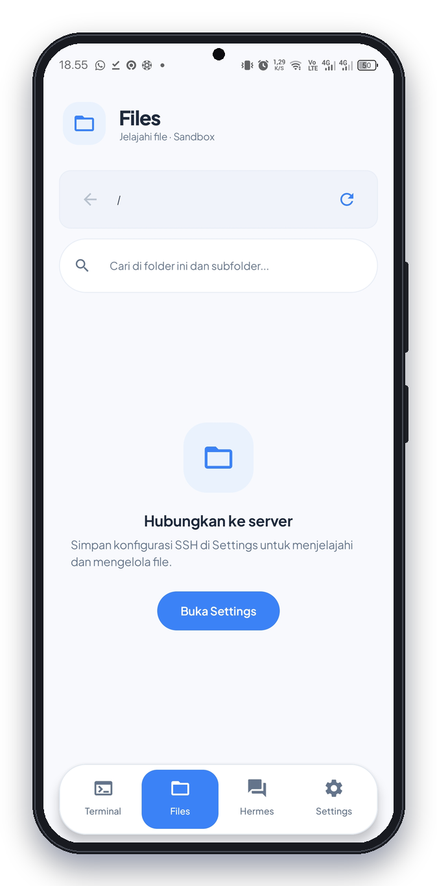
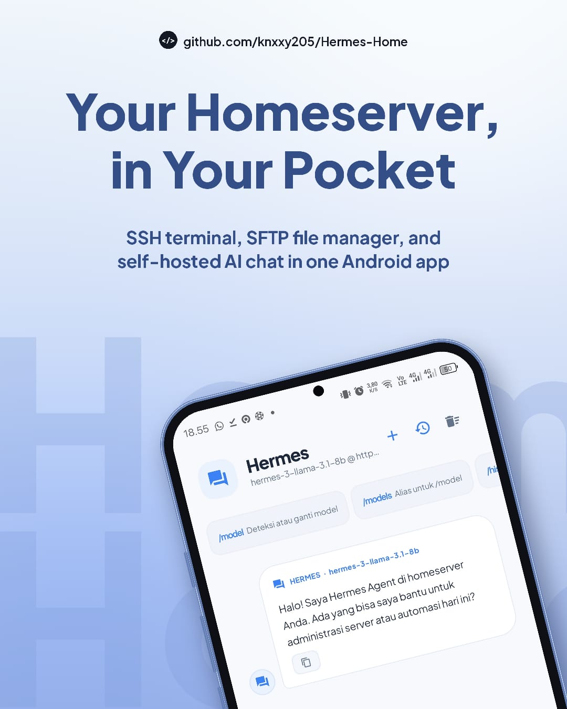

<div align="center">


# Hermes Home

**Your homeserver, in your pocket.**

An SSH terminal, an SFTP file manager, and self-hosted AI chat in one native Android app.

[](https://github.com/knxxy205/Hermes-Home/releases/tag/v1.3.1-beta.1) [](LICENSE) [](#requirements) [](#build-from-source)

[**Download APK**](https://github.com/knxxy205/Hermes-Home/releases/download/v1.3.1-beta.1/Hermes-Home-v1.3.1-beta.1.apk) · [Release notes](https://github.com/knxxy205/Hermes-Home/releases/tag/v1.3.1-beta.1) · [Getting started](#getting-started) · [Report a bug](https://github.com/knxxy205/Hermes-Home/issues)

<br />





*Unlock, Terminal, and Files. Previews show the app before connecting to a server.*

</div>

> [!IMPORTANT]
> **Use 1.3.1 Recovery Beta.** The older `1.3.0-beta.1` has a startup crash and should not be installed. Version 1.3.1 passed fresh installation, launch, device-PIN authentication, and navigation through all four tabs on an Android 14 emulator. Physical-phone testing is still needed. See [the verification record](docs/release-readiness.md).
>
> While this repository is private, APK downloads require GitHub sign-in and repository access.

## Why Hermes Home?

Hermes Home is built for people who run their own server and want to manage it from their phone. It is designed for private networks such as **Tailscale**: keep SSH and Hermes services on your private network instead of exposing them to the public internet.

Hermes Home does not provide a hosted server or AI service. You operate and secure the services you connect to.

## Features

### Terminal

- Interactive SSH terminal with an embedded terminal emulator.
- Host-key confirmation before first use and checks against previously trusted keys.
- Multiple terminal sessions and a shortcut row for common terminal keys.

### Files over SFTP

- Browse, create, rename, and delete remote files and folders; preview supported files.
- **Multi-select and recursive search**, with paths in results and a stop button.
- **Downloads to a folder you choose** through Android's folder picker. Existing filenames are preserved by numbering new copies.
- **File information** with full filenames, paths, extensions, sizes, modification times, and permissions.
- **Background uploads** that retain the destination folder with each queued batch.

### Hermes chat

- Chat with a self-hosted Hermes Agent through an OpenAI-compatible endpoint.
- Send selected file contents to Hermes for explanation and review.
- Review suggested commands and choose when to run them on your server through SSH.

<p align="center">
  
</p>

### Profiles and app lock

- **Connection profiles** for switching between server configurations.
- **Encrypted local credentials** with AES-GCM and a key held by Android Keystore.
- **Password-protected profile backups** for moving settings between devices.
- **Biometric or device-credential unlock** on supported devices.
- Privacy, security, and license documents available offline in Settings.

## Requirements

- Android 7.0 (API 24) or later.
- An SSH server with SFTP enabled for terminal and file management.
- A private network connection to your server, such as Tailscale.
- *Optional:* a self-hosted Hermes Agent endpoint that implements an OpenAI-compatible API.

## Getting started

1. [Download the latest beta APK](https://github.com/knxxy205/Hermes-Home/releases/tag/v1.3.1-beta.1) on your Android device and install it. When updating an existing GitHub beta, install over the old version to retain app data.
2. Connect the device and homeserver to the same private network.
3. Open **Settings** and enter the server's SSH host, port, username, and password.
4. Confirm the SSH host-key fingerprint using an independent, trusted connection. Investigate any changed host key before trusting it again.
5. *Optional:* configure the Hermes base URL, model, and API key. Use HTTPS for public hosts; HTTP is accepted for local or private network hosts.
6. Open **Terminal**, **Files**, or **Hermes** to use the configured services.

## Beta limitations

<details>
<summary><b>Known limitations and testing notes</b></summary>

- Downloads currently support files; folders must be downloaded file by file. Only empty folders can be deleted.
- Downloads run while the app process is alive and do not resume automatically after Android kills the app. Existing destination files are preserved; failed transfers attempt to remove their partial files.
- Search covers the current remote folder and its subfolders without following directory symlinks. It stops at 5,000 results, 10,000 scanned folders, 64 levels, or a 20-second scan budget. A blocked network request can extend that time up to the connection timeout. Partial results and unreadable folders are labeled.
- Cancelling search restores the last successfully loaded directory listing. Use Refresh to check for server changes.
- Emulator checks do not establish that live SSH/SFTP connections, fingerprint hardware, background work, and retained-data updates behave correctly on every phone.

See [the Files beta test guide](docs/files-beta-testing.md) and [release verification record](docs/release-readiness.md) before wider distribution.

</details>

## Build from source

The project uses **Kotlin**, **Jetpack Compose**, and **Gradle**. With Java 17, Gradle 9.3.1, and Android SDK 36.1 installed:

```sh
gradle :app:assembleDebug
```

The development APK is written to `app/build/outputs/apk/debug/app-debug.apk`.

- GitHub Actions checks pushes and pull requests and stores a CI debug artifact. It uses a development signing key and should not be used to update an installed GitHub beta.
- Distribution betas use a non-debuggable release variant. Minification and resource shrinking remain disabled in 1.3.1 after the optimized 1.3.0 startup regression.
- The manual release workflow builds and verifies the signed APK, then runs Android startup checks on a separate emulator runner before optional workflow publication.

See [release build and signing instructions](docs/release-build.md).

## Security and privacy

- SSH passwords and Hermes API keys are encrypted locally with AES-GCM and a key held by Android Keystore.
- SSH host keys are checked and require confirmation before first use.
- Hermes HTTP requests are restricted to local or private-network destinations, including redirects. Use HTTPS for public hosts.
- Android cloud backup and device transfer exclude the app's shared preferences.
- Profile exports contain connection credentials. Protect them with a strong backup password and keep the resulting files secure.
- Connections send data to the servers you configure. Review those services and any upstream AI providers they use.

Read the [privacy policy](PRIVACY.md) and [security reporting instructions](SECURITY.md), also available offline in Settings. The 1.3 release line removes unused Firebase/Gemini template SDKs; Hermes requests go to the endpoint you configure.

## Third-party notices

Terminal emulator and renderer sources are based on [Termux](https://github.com/termux/termux-app) v0.118.0 and are included under `app/src/main/java/com/termux`. The upstream terminal emulator code carries an Apache-2.0 exception; other applicable Termux components are GPL-3.0-only. Each APK release links to its matching source and build instructions.

See [third-party notices](THIRD_PARTY_NOTICES.md) and the full license texts in `app/src/main/assets/licenses`.

## License

Hermes Home's original code is licensed under **GNU GPL version 3 only (GPL-3.0-only)**. You may use, modify, and redistribute it under those terms, including providing corresponding source when distributing covered binaries. The app is provided without warranty.

See [LICENSE](LICENSE) and [the recorded license decision](docs/license-review.md). Third-party components retain their own notices and applicable exceptions.

<div align="center">

© 2026 knxxy205 and Hermes Home contributors

</div>
